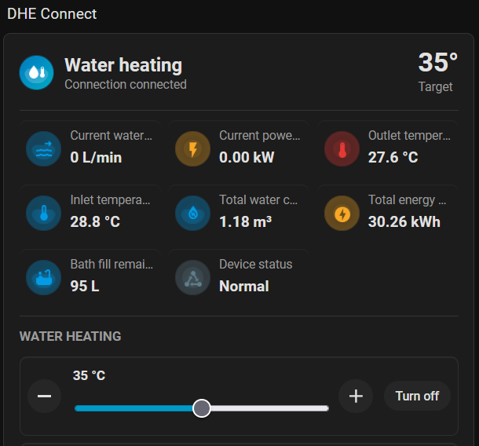

# Stiebel Eltron DHE Connect for Home Assistant (Unofficial)


[](https://github.com/memphi2/ha-dhe-connect/actions/workflows/validate.yml)
[](custom_components/stiebel_dhe_connect/quality_scale.yaml)
[](https://github.com/memphi2/ha-dhe-connect/releases)
[](https://contributors.home-assistant.io/marketplace/)
[](LICENSE)

Unofficial local Home Assistant integration for compatible Stiebel Eltron DHE Connect
instantaneous water heaters.

The integration uses the local DHE web interface only (no cloud relay).

The integration is listed as **Stiebel Eltron DHE Connect** and uses original
community artwork, not the manufacturer's logo. The display name does not
change the integration domain (`stiebel_dhe_connect`), existing entity IDs or
user-assigned device names. Existing installations do not need to be recreated.



## Status

- Current version: `2.0.10`
- Minimum supported Home Assistant version: `2026.10.4`
- Releases: published stable tags; development checkouts may be unreleased
- Quality target: Home Assistant Quality Scale Platinum track for a custom integration
- Support scope: published stable releases; development branches are best-effort

On HA 2026.10.1 through 2026.10.3, use DHE Connect v2.0.9. For older HA versions,
choose an integration release whose minimum matches your installation. Development
validation may use a preview while preparing a new HA release; stable DHE Connect
releases require validation against stable Home Assistant. The quality target
is not an official Home Assistant Core certification.

## Highlights

- Local runtime connection (Socket.IO / Engine.IO), no cloud dependency.
- Climate target temperature control with reconnect-aware behavior.
- Live water flow and live power for daily monitoring.
- Timer, eco mode, child safety, bath fill and wellness controls.
- Radio and weather support through the DHE runtime payload.
- Multi-device support: one config entry per DHE.

## Important Entities

Common entities used in dashboards and automations, with illustrative IDs:

- `climate.dhe_connect`
- `sensor.dhe_connect_connection_state`
- `sensor.dhe_connect_current_power`
- `sensor.dhe_connect_current_water_flow`
- `switch.dhe_connect_eco_mode`
- `switch.dhe_connect_bath_fill`

Complete entity reference:
[docs/entities.md](docs/entities.md)

## Quick Automation Example

```yaml
alias: DHE eco mode at night
triggers:
  - trigger: time
    at: "22:30:00"
actions:
  - action: switch.turn_on
    target:
      entity_id: switch.dhe_connect_eco_mode
mode: single
```

More automation examples and practical scenarios:

- [docs/examples.md](docs/examples.md)
- [docs/use-cases.md](docs/use-cases.md)

## Installation

### Home Assistant Marketplace (recommended)

[](https://my.home-assistant.io/redirect/marketplace_repository/?owner=memphi2&repository=ha-dhe-connect&category=integration)

For Home Assistant 2026.11 and newer:

1. Open `Settings` -> `Marketplace`.
2. Search for `DHE Connect` and open **Stiebel Eltron DHE Connect**.
3. Install the integration and confirm the community-integration notice.
4. Add **Stiebel Eltron DHE Connect** from `Settings` -> `Devices & services`
   and complete pairing on the DHE display.

The repository is in the shared catalog; no custom repository is needed.
A first Marketplace install normally loads without a restart. Complete the
requested restart after an update or removal of loaded code.

On Home Assistant 2026.10, install **Stiebel Eltron DHE Connect** from HACS,
restart Home Assistant, then add the integration under `Devices & services`.

See [installation, updates and removal](docs/installation.md) for the complete
workflow, manual installs and existing-installation guidance.

### Existing installations and updates

Keep your existing config entries, including HACS-managed installations. The
repository and domain have not changed. Marketplace updates appear under
`Settings` -> `Updates`; read the release notes before installing.

### Removal

Delete the DHE entries under `Settings` -> `Devices & services`, then uninstall
the repository from the Marketplace and complete the restart request. See the
[removal checklist](docs/installation.md#removal) for existing HACS and manual installs.

## Setup

The setup flow supports:

- Zeroconf discovery (`_ste-dhe._tcp.local.`)
- Subnet scan (private IPv4 ranges, default port `8443`)
- Manual host/port entry

Zeroconf usually requires mDNS visibility in the local subnet/VLAN or an
explicit relay setup across subnets.

The local DHE pairing token is stored in the Home Assistant config entry.
Legacy per-target token files from older versions are migrated into the config
entry. Valid source files are deleted automatically on a later HA start, once
the persisted token and migration marker have been loaded successfully.

## Security Notes

- Use only on trusted local networks.
- Do not expose the DHE web interface to the internet.
- Treat Home Assistant backups/config mounts as sensitive; config entries
  include local pairing tokens.
- Do not publish tokens, private hosts or private IPs.

See [SECURITY.md](SECURITY.md).

## Documentation

User guides:

| Topic | Document |
|---|---|
| Installation, updates and removal | [docs/installation.md](docs/installation.md) |
| German quick guide | [docs/de.md](docs/de.md) |
| Pairing, connectivity and recorder troubleshooting | [docs/troubleshooting.md](docs/troubleshooting.md) |
| Entity list, attributes and service examples | [docs/entities.md](docs/entities.md) |
| Automation examples | [docs/examples.md](docs/examples.md) |
| Practical use cases | [docs/use-cases.md](docs/use-cases.md) |
| Known limitations | [docs/known_limitations.md](docs/known_limitations.md) |
| Migration policy (v2 line) | [docs/migration_policy.md](docs/migration_policy.md) |
| Legal and asset hygiene | [docs/legal.md](docs/legal.md) |

Development and validation:

| Topic | Document |
|---|---|
| Device and firmware evidence matrix | [docs/firmware_matrix.md](docs/firmware_matrix.md) |
| Protocol and ODB reference | [docs/protocol.md](docs/protocol.md) |
| Local checks and optional live/lab gates | [docs/validation.md](docs/validation.md) |
| Release process checklist | [docs/release_process.md](docs/release_process.md) |
| Engineering and quality-scale scope | [docs/platinum_prep.md](docs/platinum_prep.md) |

## Legal Notes

This repository is an independent community project.

- Unofficial integration: no affiliation with, endorsement by, or sponsorship from
  Stiebel Eltron, Home Assistant, Nabu Casa, or HACS.
- Trademark notice: names such as Stiebel Eltron, DHE Connect, Home Assistant,
  HACS, and Nabu Casa are used only for compatibility reference and belong to
  their respective owners.
- No official Home Assistant Core certification is claimed.

See [docs/legal.md](docs/legal.md) for full legal and asset-hygiene details.
